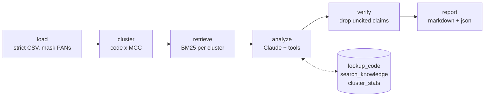

# decline-code-assistant

[](https://github.com/HelenArams/decline-code-assistant/actions/workflows/ci.yml)
[](LICENSE)

Every time the decline rate jumps, someone from ops pings me with a CSV and
"what does 05 mean again, can we retry these?". I've answered that question
enough times that I wanted the model to do it for me, but only if it could
point at where the answer comes from. So this is a small agent that takes a
CSV of failed card transactions, groups them, and explains each group with
citations into a knowledge base I wrote and can check.

It's a side project, not a product. The knowledge base is generic scheme and
ISO 8583 material, nothing issuer-specific, and it will happily tell you that
05 is a catch-all, because it is.

## What it does

- reads a CSV export of declines (strict schema, full PANs masked on read)
- clusters them by response code and MCC
- pulls the relevant sections out of `knowledge/` with plain BM25
- asks Claude to explain each cluster and say what to do, with tools to look
  up codes, search the knowledge base and re-read the cluster numbers
- throws away any claim that doesn't cite a real section (more on that below)
- writes a Markdown report plus the same thing as JSON

Runs as a CLI (`declines`) and as an MCP server (`declines-mcp`) so I can ask
about declines straight from Claude Desktop or Claude Code.



## Running it

Python 3.12.

```bash
make install                      # .venv + editable install with dev deps
source .venv/bin/activate

declines lookup 51
declines search "soft decline retry"
declines analyze samples/declines.csv --out report.md --offline
```

`--offline` swaps Claude for a rule-based stand-in that goes through the same
tool loop, so you can see the whole pipeline without a key. For the real thing:

```bash
export ANTHROPIC_API_KEY=sk-ant-...
export ANTHROPIC_MODEL=claude-sonnet-4-5   # default, override if you like
declines analyze samples/declines.csv --out report.md
```

`--out report.md` also writes `report.json` next to it. Without a key the CLI
falls back to offline and says so on stderr.

### As an MCP server

```bash
declines mcp          # or: declines-mcp
```

It speaks stdio and exposes three tools: `lookup_decline_code`,
`search_decline_knowledge` and `analyze_declines_csv` (takes a path or the CSV
text). For Claude Desktop, add this to `claude_desktop_config.json` (same thing
is in [`examples/mcp.json`](examples/mcp.json)):

```json
{
  "mcpServers": {
    "declines": {
      "command": "/absolute/path/to/decline-code-assistant/.venv/bin/declines-mcp",
      "env": { "ANTHROPIC_API_KEY": "sk-ant-..." }
    }
  }
}
```

For Claude Code:

```bash
claude mcp add declines -- /absolute/path/to/decline-code-assistant/.venv/bin/declines-mcp
```

Lookup and search don't need a key at all. Analyze uses Claude if the key is
there and the offline analyst if not.

## What the output looks like

Trimmed from `declines analyze samples/declines.csv --offline`. With Claude the
explanation is actual prose about the cluster (the 3DS mix, the retry counts,
etc.); the offline analyst just fills in the code-book facts.

```markdown
| Cluster | Count | Severity | Retry? | Action |
|---|---:|---|---|---|
| `91/5734` | 4 | high | yes | Once after a short backoff, then a second attempt a few minutes later; stop if the issuer is still down |
| `54/5968` | 3 | high | no | Only after the expiry date is updated |
| `65/5734` | 3 | medium | yes | After the window resets, or immediately with 3-D Secure authentication when used as an SCA soft decline |
| `51/5734` | 4 | low | yes | Wait at least 24 hours; schedule retries around likely payday ... |

## 65 on MCC 5734 (3 declines)

- Code 65 is a soft decline. [1]
- Retry guidance: ... immediately with 3-D Secure authentication when used as an SCA soft decline. [1], [2]
- Most rows were not 3-D Secure authenticated. [3]

Sources:
1. iso8583_response_codes.md > 65 - Exceeds withdrawal frequency limit / authentication required
2. retry_policies.md > Retry immediately with authentication (SCA soft declines)
3. merchant_fixes.md > Step up with 3-D Secure on soft declines
```

## Why there's a verify step

LLMs are good at sounding sure. Left alone, the model will sometimes add a
plausible root cause ("issuer risk rules for this BIN") that nothing in the
input supports, or cite a section that has nothing to do with the claim. For
something people act on (retrying a stolen card costs real scheme fees) that's
not OK.

So after `analyze`, every claim goes through `verify`:

- no citation, or a citation to a chunk that doesn't exist -> dropped
- cited chunk shares no meaningful words with the claim -> dropped
- model says "retryable" but the code book says it's a hard decline -> flag
  flipped back, with a note in the report

Dropped claims are counted in the report so you can see when the model was
guessing. It's a cheap lexical check, not proof, but it catches most of the
nonsense I saw.

## Things I was careful about

- **No card data in prompts.** The loader rejects any column it doesn't know
  (that's how cardholder names sneak in) and masks anything that looks like a
  PAN to BIN + last four before the row is even validated. The model only ever
  sees cluster aggregates: counts, amounts per currency, scheme and 3DS mix,
  retry counts. No PANs, no tokens, no transaction ids. Tool output is run
  through the redactor once more on the way out.
- **Tool allowlist.** The model gets three read-only tools. Anything else it
  asks for gets an error back.
- **Prompt caching.** System prompt + the response-code index are identical
  for every cluster in a run, and the last system block carries the
  `cache_control` breakpoint, so after the first cluster that prefix is a cache
  read. Tools are sorted by name for the same reason. Per-cluster stuff goes in
  the user message.
- **Structured output.** The analysis comes back through
  `output_config.format` with a JSON schema and is validated into a pydantic
  model. The final `DeclineReport` is pydantic too.
- **Deterministic evals.** The default eval run uses the offline analyst, so
  CI never needs a key and never flakes.

## Knowledge base

Plain markdown in `knowledge/`. Each `#`/`##` heading is one chunk, cited as
`file.md#heading-slug`. Response codes follow a fixed shape so they can be
parsed into a lookup table (the CLI, the tools and the MCP server all read from
the same text the model cites):

```markdown
## 51 - Insufficient funds

- **Group:** issuer / account balance
- **Kind:** soft
- **Retryable:** yes - wait at least 24 hours; ...
- **Severity:** low

Free text explanation...
```

Files: response codes, decline reason groups (issuer / acquirer / network,
soft vs hard), 3DS2 outcomes, merchant-side fixes, retry policies. Retrieval is
behind a small `Retriever` protocol (`search`, `get`), so swapping BM25 for a
vector store is one class. Honestly at this size BM25 does fine.

## Input format

```
id,timestamp,masked_pan,amount,currency,mcc,response_code,scheme,three_ds_status,retry_count
tx-1001,2026-03-02T08:14:03Z,411111******1111,49.90,EUR,5734,51,visa,Y,1
```

`masked_pan` can be a masked PAN or a token. `three_ds_status` is the EMV 3DS
`transStatus` (Y/A/N/U/R/C/D/I) or `none`. Extra columns are an error, on
purpose.

## Code layout

```
src/decline_assistant/
  loader.py, masking.py      strict CSV + PAN masking
  clustering.py              code x MCC clusters and their stats
  knowledge/                 chunker, BM25 retriever, code book
  llm/                       client protocol, Anthropic adapter, prompts, tools,
                             scripted fake (tests) and offline analyst (demo/evals)
  graph/                     LangGraph nodes, analyze loop, verify
  report.py                  DeclineReport + markdown/json rendering
  cli.py, mcp_server.py      the two front doors
  evals.py                   golden case runner
knowledge/                   the knowledge base
samples/declines.csv         24 made-up declines
evals/cases.yaml             golden cases
```

## Tests and evals

```bash
make lint    # ruff + mypy --strict
make test    # pytest, fully offline
make eval    # golden cases with the offline analyst
make eval-live   # same cases against Claude, needs ANTHROPIC_API_KEY
```

Tests use `FakeAnthropic`, which returns scripted tool calls and answers and
records every request, so the end-to-end test can check things like "the
prefix sent for both calls is identical" and "no PAN fragment ever reached the
model". The evals check facts that must not drift (retryable flag, which
sections get cited, key words in the action), not wording. `--live` is the
interesting run: it's where you find out if a prompt change made the model
start suggesting retries on stolen cards.

## Roadmap-ish

- [ ] slice clusters by issuer BIN / country too, half the 05 questions need it
- [ ] verify is lexical only, try a cheap second model pass and see if it's worth the tokens
- [ ] gateway-specific reason codes as a second knowledge file

## License

MIT, see [LICENSE](LICENSE).
